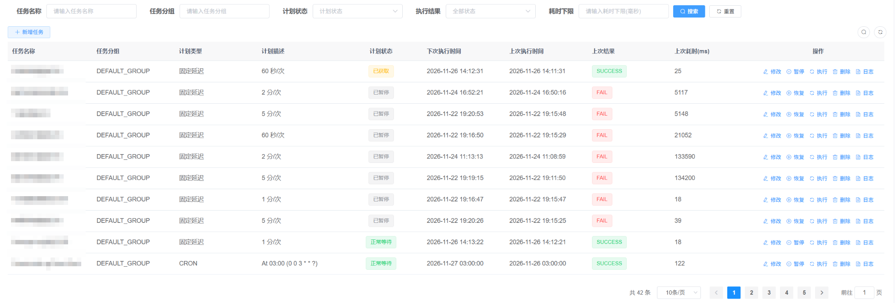
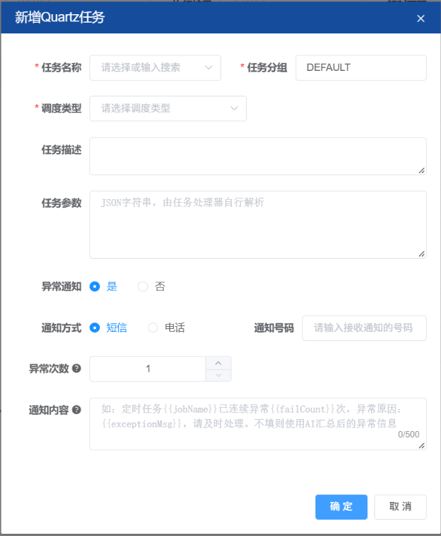
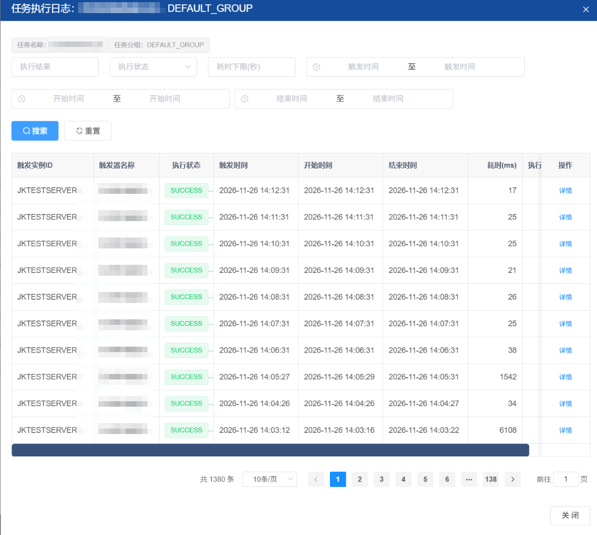
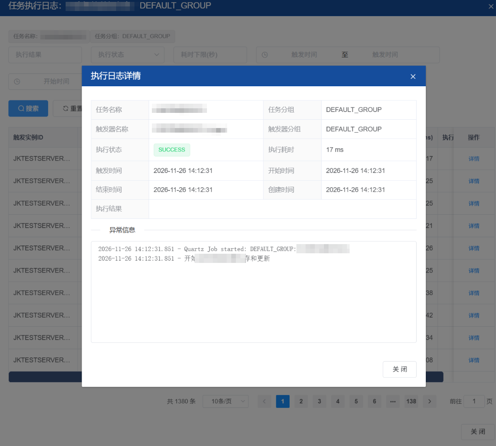

# Quartz for Jboot 定时任务管理模块

基于 **Quartz 2.5.2 + Jboot 4.1.9（JFinal）** 的定时任务管理模块。提供注解自动注册、Web 端动态管理、执行日志、异常告警与 FIXED_DELAY 调度能力，可直接嵌入 Jboot 项目使用。

## 功能特性

- **注解声明任务**：`@QuartzSchedule` 标注 `Job` 实现类，启动时自动扫描并注册，无需改配置文件。
- **Web 动态管理**：任务分页查询、新增、修改、暂停/恢复、立即执行、删除。
- **多种调度类型**：CRON、FIXED_DELAY（上次执行完成后延迟）、SIMPLE、CALENDAR_INTERVAL、DAILY_TIME_INTERVAL。
- **执行日志**：每次执行自动写入 `QUARTZ_JOB_LOG`（RUNNING → SUCCESS / FAIL / VETOED），记录触发时间、开始/结束时间、耗时、执行结果与异常信息。
- **异常日志收集**：通过 Logback Appender 收集任务线程内被业务代码 `catch` 后只打印的 ERROR 日志，任务结束时一并落库并判定为失败。
- **异常告警**：连续失败达到配置次数时发布事件 `quartz_job_exception_notify`，由业务模块发送短信 / 电话，支持自定义通知内容（`{{jobName}}`、`{{failCount}}`、`{{exceptionMsg}}` 占位符）。
- **持久化或内存**：支持 JDBCJobStore（Oracle，任务重启保留）与 RAMJobStore（内存，重启丢失）两种模式。
- **复用现有连接池**：通过自定义 `ConnectionProvider` 复用 Jboot 数据源，无需引入 c3p0。
- **执行日志清理**：按任务保留最近 N 条已完成日志，VETOED 按天数清理，分批删除避免大事务。
- **Cron 中文描述**：列表直接展示 Cron 表达式对应的中文含义。

## 界面效果

任务管理列表：支持按任务名称、分组、计划状态、执行结果、耗时下限筛选，展示下次/上次执行时间、上次结果与耗时。



新增任务：选择任务名称与调度类型，可配置任务参数、异常通知方式（短信 / 电话）、通知号码、异常次数与通知内容。
<br>
<br>
<br>
<div align="center" style="margin:20px 0;">
   </img>
</div>
<br>
<br>
<br>
任务执行日志：按触发时间、开始时间、结束时间、执行状态、耗时下限等条件查询，支持分页。
<br>
<br>
<br>


<br>
<br>
<br>
日志详情：展示单次执行的完整信息、执行结果与异常信息。
<br>
<br>
<br>


## 模块结构

```
quartz-module
├── front
│   ├── js/quartz.js                        前端接口封装（/quartz/*）
│   └── vue/index.vue                       任务管理页面（Vue2 + Element UI）
├── src/main/java/com/sxs/quartz
│   ├── QuartzSchedulerManager.java         Scheduler 生命周期与 Job 操作入口
│   ├── annotation/QuartzSchedule.java      任务声明注解
│   ├── config/QuartzConfig.java            quartz.* 配置绑定
│   ├── config/QuartzScheduleConfig.java    运行时调度配置（可序列化，存入 JobDataMap）
│   ├── constant/QuartzScheduleType.java    调度类型枚举
│   ├── datasource/JbootQuartzConnectionProvider.java  复用 Jboot 连接池
│   ├── dto/QuartzTaskParam.java            新增/修改请求参数
│   ├── dto/QuartzJobLog.java               执行日志实体（QUARTZ_JOB_LOG）
│   ├── factory/JbootSimpleJobFactory.java  Job 实例由 JFinal Aop 创建（支持 @Inject）
│   ├── factory/QuartzTriggerFactory.java   按调度类型创建 Trigger
│   ├── listener/QuartzJobListener.java     全局 Job 监听器：日志与 FIXED_DELAY 续约
│   ├── log/QuartzJobLogContext.java        任务线程错误日志上下文
│   ├── log/QuartzJobErrorAppender.java     Logback ERROR/INFO 日志收集
│   ├── notify/QuartzJobExceptionNotifier.java  连续失败告警事件
│   ├── service/QuartzService.java          任务查询与增删改查业务
│   ├── service/QuartzLogService.java       执行日志服务
│   └── util/                               Cron 中文描述、分页、数据源工具
├── src/main/resources/sql/quartz_tables_oracle.sql   Quartz 11 张 QRTZ_* 表建表脚本
├── docs/images/                            界面截图
└── pom.xml
```

> 说明：本仓库只包含调度内核、日志/告警能力与管理页面资源。REST 接口（`QuartzController`）未包含在本仓库中，接入方可参考下方接口约定自行实现。

## 环境要求

| 项目 | 版本 / 说明 |
| --- | --- |
| JDK | 21（`maven.compiler.source/target = 21`） |
| Maven | 3.8+ |
| Quartz | 2.5.2 |
| Jboot | 4.1.9 |
| 数据库 | Oracle；JDBCJobStore 模式需创建 `QRTZ_*` 表，内存模式无需 |
| 前端 | Vue 2 + Element UI（若依风格页面） |

## 快速开始

### 1. 引入依赖

```xml
<dependency>
    <groupId>com.sxs</groupId>
    <artifactId>sxs-quartz-module</artifactId>
    <version>1.0-SNAPSHOT</version>
</dependency>
```

本模块 `pom.xml` 的 `parent` 指向内部父工程，父 POM 未随本仓库提供。独立构建时，请将 `parent` 调整为实际使用的父工程坐标，或先将父 POM 安装到本地仓库（`mvn install`）。

> 注意：`artifactId` / 包名不要以 `quartz` 开头，Jboot 默认不扫描以 quartz 开头的包，会导致 `@Bean`、`@Table` 失效。

### 2. 初始化数据库

持久化模式需在业务库执行 `src/main/resources/sql/quartz_tables_oracle.sql`。脚本会创建 `QRTZ_*` 共 11 张 Quartz 表（默认前缀 `QRTZ_`，与 `quartz.properties` 中 `tablePrefix` 保持一致）。

执行日志表由业务侧维护，字段与 `QuartzJobLog` 实体一致，参考 DDL：

```sql
CREATE TABLE QUARTZ_JOB_LOG (
    ID               VARCHAR2(64) NOT NULL,
    FIRE_INSTANCE_ID VARCHAR2(200),
    JOB_NAME         VARCHAR2(200),
    JOB_GROUP        VARCHAR2(200),
    TRIGGER_NAME     VARCHAR2(200),
    TRIGGER_GROUP    VARCHAR2(200),
    FIRE_TIME        TIMESTAMP,
    START_TIME       TIMESTAMP,
    END_TIME         TIMESTAMP,
    DURATION         NUMBER(19),
    EXECUTE_STATUS   VARCHAR2(20),
    RESULT_MSG       VARCHAR2(4000),
    EXCEPTION_MSG    CLOB,
    CREATE_TIME      TIMESTAMP,
    CONSTRAINT QUARTZ_JOB_LOG_PK PRIMARY KEY (ID)
);

CREATE INDEX IDX_QUARTZ_LOG_JOB
    ON QUARTZ_JOB_LOG (JOB_NAME, JOB_GROUP, FIRE_TIME);
```

### 3. 配置 `jboot.properties`

```properties
# 总开关
quartz.enable=true
# 复用 jboot.datasource.* 中的数据源，Quartz 与其共用连接池
quartz.datasource.key=yourDatasourceKey

# 执行日志清理参数（由日志清理任务读取）
quartz.log.keepCount=5000
quartz.log.vetoedKeepDays=7
quartz.log.cleanBatchSize=5000
```

### 4. 配置 `quartz.properties`

放在 classpath 下，Quartz 启动时自动加载：

```properties
org.quartz.scheduler.instanceName = YourScheduler
org.quartz.scheduler.instanceId = AUTO

# 线程池
org.quartz.threadPool.class = org.quartz.simpl.SimpleThreadPool
org.quartz.threadPool.threadCount = 20

# JobStore：持久化（Oracle）
org.quartz.jobStore.class = org.quartz.impl.jdbcjobstore.JobStoreTX
org.quartz.jobStore.driverDelegateClass = org.quartz.impl.jdbcjobstore.oracle.OracleDelegate
org.quartz.jobStore.tablePrefix = QRTZ_
org.quartz.jobStore.isClustered = true
org.quartz.jobStore.misfireThreshold = 60000
```

不需要持久化时，将 JobStore 改为内存模式即可：

```properties
org.quartz.jobStore.class = org.quartz.simpl.RAMJobStore
```

数据源信息不在 `quartz.properties` 中重复配置。模块初始化时仍会按 `quartz.datasource.key` 查找对应的 Jboot 数据源并注入 `JbootQuartzConnectionProvider`，因此该 key 必须指向一个已配置的数据源。

### 5. 配置 Logback

在 `logback.xml` 的 `<root>` 下注册日志收集 Appender。**不要包在 `AsyncAppender` 中**，异步线程会丢失任务线程上下文：

```xml
<appender name="QUARTZ-JOB-ERROR" class="com.sxs.quartz.log.QuartzJobErrorAppender">
    <filter class="ch.qos.logback.classic.filter.ThresholdFilter">
        <level>INFO</level>
    </filter>
</appender>

<root level="info">
    <!-- 其他 appender -->
    <appender-ref ref="QUARTZ-JOB-ERROR"/>
</root>
```

Appender 只收集 Quartz 工作线程（线程名前缀为调度器实例名或 `threadNamePrefix` + `_Worker`）在任务执行期间产生的日志：单条最长 1000 字符、单次最多 50 条、累计最多 10000 字符。

### 6. 前端接入

将 `front/js/quartz.js` 放到前端 `src/api/quartz/quartz.js`，将 `front/vue/index.vue` 放到 `src/views/quartz/index.vue`，再配置菜单路由即可。页面依赖若依风格的 `request` 工具与 `right-toolbar` 组件。

## 使用方式

### 注解声明任务

```java
@Slf4j
@Bean
@QuartzSchedule(
        value = "0 0/5 * * * ?",
        jobName = "TrafficDataJob",
        jobGroup = "DEFAULT_GROUP",
        description = "每 5 分钟采集一次交通数据",
        enabled = true)
public class TrafficDataJob implements Job {

    @Inject
    private TrafficService trafficService;

    @Override
    public void execute(JobExecutionContext context) {
        trafficService.collect();
    }
}
```

- Job 实例由 `JbootSimpleJobFactory` 通过 `Aop.get(jobClass)` 创建，因此支持 JFinal `@Inject`。
- `enabled = false` 时只注册 JobDetail（持久化、可在管理端看到），不创建 Trigger，即不会自动执行。
- `jobName` 必须显式指定且全局唯一（同一分组内），Trigger 名称默认按 `{jobName}_trigger` 生成。

### 注解参数

| 属性 | 默认值 | 说明 |
| --- | --- | --- |
| `value` | `0 */2 * * * ?` | Quartz Cron（秒 分 时 日 月 周 [年]） |
| `jobName` | 空 | Job 名称，必填 |
| `jobGroup` | `DEFAULT_GROUP` | Job 分组 |
| `description` | 空 | 任务描述 |
| `type` | `CRON` | 调度类型 |
| `interval` | `60` | 固定间隔数值，配合 `intervalUnit` |
| `intervalUnit` | `SECOND` | 间隔单位 |
| `enabled` | `true` | 是否注册 Trigger |
| `params` | 空 | 任务参数（JSON 字符串，由任务自行解析） |

### 调度类型

| 类型 | 说明 | 管理端支持 |
| --- | --- | --- |
| `CRON` | Cron 表达式调度 | 是 |
| `FIXED_DELAY` | 上次执行完成后延迟指定时间再执行下一次 | 是 |
| `SIMPLE` | 固定间隔重复执行 | 注解 / 编程式 |
| `CALENDAR_INTERVAL` | 日历间隔（按月、年等） | 注解 / 编程式 |
| `DAILY_TIME_INTERVAL` | 每日时间范围（默认 09:00–18:00）内的固定间隔 | 注解 / 编程式 |

`FIXED_DELAY` 首次 Trigger 只执行一次，后续由 `QuartzJobListener` 在任务结束后按配置的间隔重建下一个单次 Trigger，因此不会出现任务未结束就再次触发的情况。

### 编程式管理

`QuartzSchedulerManager` 由 Jboot 以单例 Bean 管理，业务代码通过 `@Inject` 使用：

```java
@Inject
private QuartzSchedulerManager manager;

public void demo() throws SchedulerException {
    manager.pauseJob("TrafficDataJob", "DEFAULT_GROUP");    // 暂停
    manager.resumeJob("TrafficDataJob", "DEFAULT_GROUP");   // 恢复
    manager.triggerJob("TrafficDataJob", "DEFAULT_GROUP");  // 立即执行一次
    manager.deleteJob("TrafficDataJob", "DEFAULT_GROUP");   // 删除

    manager.isJobPaused(manager.triggerKey("TrafficDataJob", "DEFAULT_GROUP"));
    manager.isStarted();
}
```

### 管理接口

模块本身不注册 Controller，宿主项目按以下约定实现：

| 方法 | 路径 | 参数 | 说明 |
| --- | --- | --- | --- |
| GET | `/quartz/list` | `page`、`limit`、`jobName`、`jobGroup`、`triggerState`、`executeStatus`、`minDuration` | 任务分页列表 |
| GET | `/quartz/getAllJobList` | - | 所有任务名称 |
| GET | `/quartz/info` | `jobName`、`jobGroup` | 任务详情 |
| POST | `/quartz/save` | `QuartzTaskParam` JSON | 新增任务 |
| POST | `/quartz/update` | `QuartzTaskParam` JSON | 修改任务 |
| POST | `/quartz/pause` | `jobName`、`jobGroup` | 暂停 |
| POST | `/quartz/resume` | `jobName`、`jobGroup` | 恢复 |
| POST | `/quartz/trigger` | `jobName`、`jobGroup` | 立即执行一次 |
| POST | `/quartz/remove` | `jobName`、`jobGroup` | 删除 |
| POST | `/quartz/pageLogNew` | 任务名称/分组、执行状态、耗时下限、时间范围、分页 | 执行日志分页 |

## 执行日志与异常告警

### 日志状态

| 状态 | 含义 |
| --- | --- |
| `RUNNING` | 任务开始执行，已写入开始时间 |
| `SUCCESS` | 执行完成且未抛出异常 |
| `FAIL` | 抛出异常，或任务线程内产生了 ERROR 日志 |
| `VETOED` | Trigger 被否决，未真正执行 |

`RESULT_MSG` 保存 `JobExecutionContext#setResult` 的内容（截断 2000 字符），`EXCEPTION_MSG` 保存异常堆栈与任务线程内收集到的错误日志。

### 异常通知

- 事件主题：`quartz_job_exception_notify`，通过 `Jboot.sendEvent(topic, data)` 发布。
- 触发条件：任务开启异常通知，且**连续**失败次数刚好等于配置的 `exceptionCount`（只通知一次，执行成功后重新计数）。
- 事件数据包含：`jobName`、`jobGroup`、`notifyType`（`SMS` / `PHONE`）、`notifyPhone`、`exceptionCount`、`failCount`、`exceptionMsg`、`notifyContent`。
- 业务模块监听该事件后，从 `data` 中取出 `notifyType`、`notifyPhone`、`notifyContent` 等字段，即可接入短信 / 电话通道。

### 日志清理

`QuartzLogService#cleanHistory(keepCount, vetoedKeepDays, batchSize)` 规则：

1. `SUCCESS` / `FAIL`：按任务（名称 + 分组）保留最近 `keepCount` 条；
2. `VETOED`：保留 `vetoedKeepDays` 天；
3. `RUNNING`：不清理；
4. 每批最多删除 `batchSize` 条，避免大事务。

宿主项目可添加一个每天凌晨执行的清理任务：

```java
@Bean
@QuartzSchedule(value = "0 0 3 * * ?", jobName = "QuartzJobLogCleanTask",
        description = "清理 Quartz 执行日志", enabled = true)
public class QuartzJobLogCleanTask implements Job {

    @Inject
    private QuartzLogService quartzLogService;

    @Override
    public void execute(JobExecutionContext context) {
        // 实际项目可从 quartz.log.keepCount / vetoedKeepDays / cleanBatchSize 读取
        long deleted = quartzLogService.cleanHistory(5000, 7, 5000);
        context.setResult("清理完成，删除 " + deleted + " 条");
    }
}
```

## 设计要点

- **复用数据源**：Quartz 默认使用 `C3p0PoolingConnectionProvider`，项目未引入 c3p0 会导致 `NoClassDefFoundError`。模块通过 `JbootQuartzConnectionProvider` 直接借用 Jboot 已创建的连接池，Quartz 停止时只清除引用，不关闭共享连接池。
- **多实例隔离**：`QRTZ_*` 表以 `SCHED_NAME` 区分调度器实例。任务列表、日志关联均按当前 Scheduler 名称过滤，避免多个服务共用同一套表时取到其他实例的数据。
- **日志失败不影响任务**：监听器内所有日志、通知操作均单独捕获异常，不会因为写日志失败中断业务任务。
- **Cron 中文描述**：基于 `cron-expression-descriptor` 将表达式转换为中文说明，列表直接展示。
- **列表关联最近一次执行**：通过 `ROW_NUMBER() OVER (PARTITION BY JOB_NAME, JOB_GROUP, TRIGGER_NAME ORDER BY FIRE_TIME DESC)` 关联 `QUARTZ_JOB_LOG` 的最新记录，展示上次结果与耗时。
